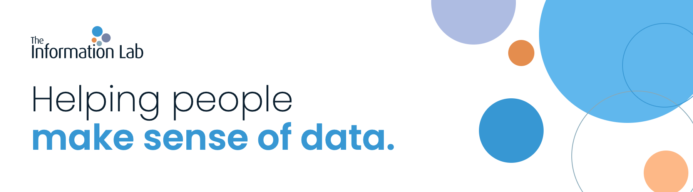

<picture>
  <source media="(prefers-color-scheme: dark)" srcset="https://raw.githubusercontent.com/TheInformationLab/.github/main/profile/banner-dark.png">
  
</picture>

The Information Lab is a global team of data enthusiasts. We help organisations get value from their data through skills, technology and processes, and this is where we share some of the code we build along the way.

[Website](https://www.theinformationlab.co.uk) &nbsp;&middot;&nbsp; [The Data School](https://www.thedataschool.co.uk) &nbsp;&middot;&nbsp; [LinkedIn](https://www.linkedin.com/company/the-information-lab/) &nbsp;&middot;&nbsp; [Email us](mailto:info@theinformationlab.co.uk)

## What we do

| Data Engineering | Analytics | Training | Licensing & Hosting |
|---|---|---|---|
| We build and maintain the pipelines and transformation layers that analysts and BI teams depend on, using tools such as dbt. | Dashboards in Tableau, data preparation in Alteryx, and the support to get teams using them. | Courses for teams learning Tableau, Alteryx and dbt. | Licensing and hosting for the platforms we work with. |

We partner with Tableau, Alteryx, dbt, Fivetran, Snowflake and AWS.

## Code worth starting with

Most of what you will find here is starter code, examples and training material. A few places to begin:

| Repository | What it is | Good for |
|---|---|---|
| [tableau_mcp_starter_kit](https://github.com/TheInformationLab/tableau_mcp_starter_kit) | Tableau MCP with LangChain, in Python | Adding AI features on top of Tableau data |
| [tableau-embedding-starter](https://github.com/TheInformationLab/tableau-embedding-starter) | A starter template for embedding Tableau dashboards in an app | Developers building portals |
| [Tableau-Extension-ExportAll](https://github.com/TheInformationLab/Tableau-Extension-ExportAll) | A dashboard extension that exports summary data to Excel | Tableau authors who need exports |
| [tableau-tools](https://github.com/TheInformationLab/tableau-tools) | A collection of small Tableau helpers | Tableau administrators |
| [Alteryx-Server-maintenance](https://github.com/TheInformationLab/Alteryx-Server-maintenance) | Housekeeping and maintenance tasks to schedule on Alteryx Server | Alteryx Server administrators |
| [dbtEssentialsGuide](https://github.com/TheInformationLab/dbtEssentialsGuide) | Step-by-step instructions from our dbt essentials training | Anyone learning dbt |

## The Data School

The Data School is our paid training programme. Since 2015 it has trained hundreds of people for careers in data analytics and data engineering, and alumni go on to well-known businesses or join us as consultants. It runs in London, Hamburg and New York.

There are two tracks, and both start the same way: you build something and show it to us.

| | Analytics | Engineering |
|---|---|---|
| **You build** | A Tableau visualisation on a dataset you care about, published to Tableau Public. | A small data pipeline, end to end, in a public GitHub repository. |
| **You send us** | The link, with a short note about yourself. You do not need a CV at this stage. | The repository link, through the application form. |
| **Then** | A video call about your work, followed by an interview at the office. | A video call about your project, then a final stage: a new brief, and an interview at our office that includes a short exercise without AI. |

Open locations change, so check the [apply page](https://www.thedataschool.co.uk/apply/) for what is available now.

### The engineering track

You do not need a degree, a previous engineering job or a GitHub history. You need something new that you built for us, in SQL, Python, R or a shell script.

1. Pick a free API on a subject you care about. Choose one with enough mess that you have to make decisions. A single endpoint returning ten tidy rows will not give you much to talk about.
2. Commit the raw response exactly as it came back, before you change anything.
3. Shape it into a clean, consistent table, or a small data model of several tables that relate to each other.
4. Use it: an app, a dashboard, a report or an alert. We weigh this part lightest.
5. Write a README that covers who it is for, the data, how it works, how to run it, what you would do next, and where AI helped.

A few ground rules. Keep your API key and any other credentials out of the repository and its history. Commit as you go, so we can see how you worked. Make sure everything after the raw data runs from a clean clone.

You can use AI. Tell us where it helped, what you kept and what you changed, and be ready to talk an engineer through your project.

We care most about how you get the data into shape. A strong submission solves a specific problem for a specific person, and you can say who would use it and what you left out on purpose.

**See what good looks like.** The examples below were built by our own team, not by applicants. They use different data, different stacks and different audiences. [Browse them all](https://github.com/orgs/TheInformationLab/repositories?q=topic%3Ades-example).

| Example | Data | Built with | For |
|---|---|---|---|
| [des-application-example](https://github.com/TheInformationLab/des-application-example) | UK food hygiene ratings | Python, SQL, DuckDB, Streamlit | Office workers choosing lunch near our City of London office |
<!-- add a row for each team example as it joins the org -->

Ready? [Apply on The Data School site](https://www.thedataschool.co.uk/apply/).

## About these repositories

Repositories here are starters, examples and training material, provided as they are. Archived repositories are no longer maintained. If you find a problem, open an issue on the repository concerned.

The Information Lab, 25 Watling Street, London EC4M 9BR
